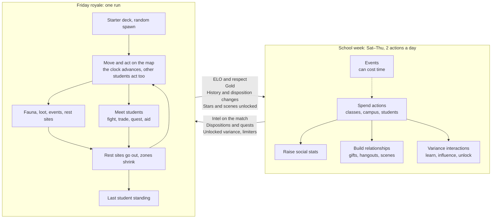
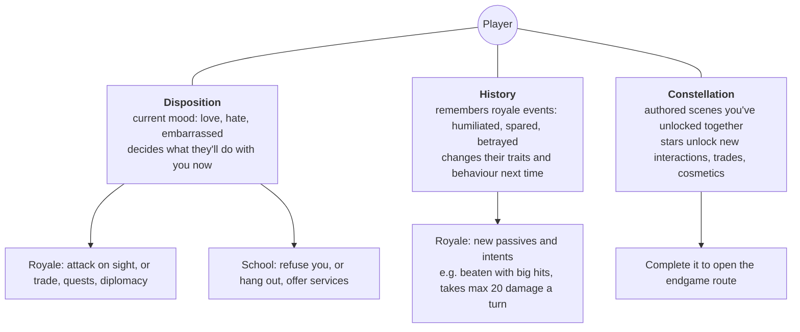
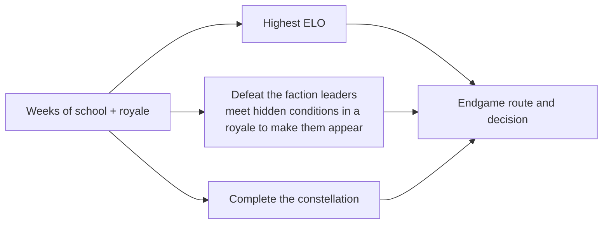

# Royale — Design Doc

## Concept

# Thesis

- **Relationships vs. power**
	- A mash-up of two genres, social sim and roguelite, in a battle royale combat school.
		- Players fight other students in a weekly battle royale to raise their ELO and status in the school. Between royales they attend school, where they raise social stats, build relationships with students, and prepare for the next royale.
		- The loops feed each other:
			- How you stand with a student decides how they meet you in the royale: fighting, trading, talking, asking for help.
			- What happens in the royale changes your relationships at school; what you do at school changes what happens in the next royale.
			- We want many flavorful interactions between the two loops.
	- Players build relationships and use them to gain power.
		- Early on, relationships and power grow together.
		- Over time they pull against each other:
			- **Prioritization.** Students' quests grow harder, some are timed, and some need conditions that come up rarely by chance. You can't do them all, so you choose whom to serve.
			- **Loot vs. diplomacy.** Fighting a student usually gives better loot than trading with them, but lowers their disposition if they wanted a diplomatic solution.
			- **Taking sides.** Students ask you to help them against another student.
			- And in the end, only one student wins the royale.
- **Variance**
	- Runs should differ wildly: different quests, different kinds of relationships with students.
	- This unlocks scenes, advances the main story (the requirements for challenging faction leaders) and adds variance to future runs, which adds variance to school life.
- **Combat** started as Slay the Spire combat with a few major tweaks. Subject to change.

# Structure

- **A run is one royale.** Cards, relics and upgrades gained in a royale last for that royale only. Every royale starts from the starter deck.
- **The campaign** is a series of weeks, each a school week followed by a royale on Friday.
	- Relationships, ELO, social stats and the constellation persist across weeks.
- **Goals**, which together open an endgame route and decision:
	- Reach the highest ELO.
	- Defeat all the faction leaders.
	- Complete the constellation.

# Setting

- Modern dark academia.
- Clans and factions who wield magic, vying for power, send their children to a military school.
	- Family clans are mostly narrative flavor, not a mechanic players deal with directly.
- The school holds a weekly battle royale that sets each student's ELO ranking and status.
- You are a poor student with no allegiance, set on becoming the most powerful. You stay unaligned.
- BDSM-style personalities and progression.
- Platform: web only for now.

# Students

- Students are the main relationships the player develops.
	- 3 factions × 6 students = 18 students.
		- Per faction: 1 leader, 2 lieutenants, 3 soldiers.
	- 8 students per royale, the player included.
- **The world moves on its own.** Students' ranks, relationships and moods are simulated in the background, whether or not the player is involved.
- **Rankings**
	- **ELO:** a student's overall standing in the school.
	- **Faction rank:** standing within their faction. *Undecided whether this system stays.*
	- As students rise in their factions they're more likely to be the final student in a royale, where they have more interesting movesets, passives and gimmicks.
- **Dimensions**
	- Clan
	- Magic archetype (their primary ability)
	- Faction, and rank within it
	- Combat
		- Relics (passives)
		- Traits
			- Passives: "takes max 20 damage a turn", "intangible every other turn"
			- Intents: "aggressive: only attacks"
- **Relationship with the player** — three parts, all describing how this student stands with you:
	- **Disposition:** their current mood toward you (love, hate, embarrassed…). Temporary.
		- Shapes both loops. If they hate you, they refuse to deal with you and attack on sight. If they like you, they offer services, hang out, and are more likely to offer diplomatic options in royales.
		- You can shift it: gifts, actions together. A student you humiliated may come for revenge next royale, but their favorite pie can calm them and make that less likely.
		- It changes which encounters you get in royales: a friendly student is more likely to show up to trade, or to ask you to defeat another student.
	- **History:** a nemesis-style memory of royale events with you: humiliated them, spared them, traded with or refused them, beat them with poison, beat you with multi-hits.
		- It changes how they fight. A student beaten with big attacks may equip "takes max 20 damage a turn", making you wear them down.
	- **Constellation:** the web of authored scenes you've unlocked together. See below.
- **Manipulating hierarchies.** Players work the factions' hierarchies to gather information and unlock the requirements for fighting faction leaders.
- Students have triggers that unlock all kinds of content: scenes, quests, variance.

# The Constellation

- Relationships aren't linear, as in most dating sims. They're dynamic and explore many different situations.
- Progress is a **constellation**: a web of stars, each an authored narrative moment the player and a student have been through.
	- One constellation holds every relationship: the player in the center, each major relationship branching out to its situations and outcomes.
	- It is both the relationship tracker and the quest tracker.
- You reach a star by meeting its conditions: "meet in combat for the first time", "defeat them with fire after spending a night together". Conditions grow more complex and niche as the relationship deepens.
- Reaching a star unlocks:
	- New stars to reach, with their own requirements
	- New interactions and trading options with that student (advantages, but never numerical ones)
	- Cosmetics: outfits, student actions, etc.
- Completing the constellation opens the endgame route.

# Royale Loop

- **One run.** You spawn at a random place on the map with the starter deck. The goal is to be the last student standing.
- **Time.** Moving and acting advance a clock; the other students move and act at the same time.
	- A combat takes one action slot.
	- Fights between other students are simulated off screen. Notices go out periodically saying who lost.
- **Zones.** The areas around rest sites are safe. As the match goes on, rest sites are marked to go out; students outside the safe zones take damage, which forces them into small zones and into each other.
- **The map** is a node graph, like Slay the Spire's, except you can move to any adjacent node, including ones you've visited.
	- Students fight fauna, gather resources and information, and fight each other for bigger power spikes at higher risk.
- **Length.** About 60–70 minutes for a full royale, like a Slay the Spire run. Players will often lose earlier, even in the early rounds.
	- About 3 student fights, more or fewer depending on your actions, and about as many fauna fights as a Slay the Spire run.
- **Map actions** (each costs time)
	- Investigate: yields resources. Can repeat at lower odds; traits affect the odds or find rare resources.
	- Hide: ambush students, or avoid them.
	- Scout: reveal what's at neighboring nodes.
	- Set a trap?
- **Combat**
	- Slay the Spire–style: build a deck, spend energy, bring the enemy to 0 HP.
- **Events and rest sites**
	- Meet students
		- Trade: relics, cards, potions
		- Quests: "kill this student", "get these potions". Some are timed or have rare conditions.
		- Requests for help against another student
		- Visit their tent
		- Make a bet
	- Caches: potions, gold, etc.
	- Mini-games? (like Slay the Spire's wheel or tile reveal)
	- Rest; lose or heal HP
	- Upgrade cards; remove cards and curses
	- Spend gold
- **Faction leaders** *(undecided)*: probably revealed like a boss when you meet certain conditions during a royale. How to make them appear may be one of the mysteries the game unveils.
- **Match variations** (differ from run to run; see Variance)
- **Losing:** your ELO drops and other students respect you less.
- **What carries to the School Loop**
	- Leftover gold
	- ELO change (win, placement or loss)
	- Relationship changes: disposition and history
		- Who won or lost against whom
		- Which cards or effects stood out in fights
		- Events, collaborations, quests
	- Stars unlocked
	- Injuries (see Time)

# School Loop

- **Meta-progression is only variance, cosmetics, indirect royale advantages (information, manipulation), or things exclusive to the school.**
	- No stat upgrades for the royale; no numerical advantage from meta-progression.
	- Unlocked variance drives unlocks, and unlocks drive more variance.
		- A student asks you to win with a certain pair of archetypes; doing so unlocks cards that fit both, which may unlock a quest that uses those cards, and so on.
		- A teacher asks you to win with a 5-card deck, which unlocks a scene with that teacher.
- **Time**
	- A week between royales. The royale takes all of Friday, leaving 6 days × 2 actions = 12 actions.
	- Events, injuries and the infirmary can take actions away. You can cripple a student, or be crippled, and lose time.
	- Students and campus areas have schedules and availability.
		- Mon–Thu: classes and campus activities.
		- Weekend: weekend-only actions while campus is closed, and fresh reactions to Friday's royale.
	- Students in the same place let you double up.
	- Events are random.
	- Players choose which variance interactions and events to prioritize.
	- (Could auto-plan the week and summarize it for players who'd rather skip it.)
- **Social stats**, in the style of Persona 4. They gate dialogue options, star requirements and actions.
- **Relationships:** gifts, hangouts and scenes shift disposition and unlock stars.
- **Manipulating hierarchies and relationships:** lateral changes to the variance.
- **Gold:** earned in royales; spent on gifts, some school actions, and cosmetics at a shop.
- **Events**
	- Cutscenes: student scenes (relationship, sex), main story
	- Random events that shake things up
- **Variance interactions**: ways to work on the next match's makeup. *An ongoing list.*
	- Through campus activities, student interactions, and events, you can:
		- Gather information on it
		- Influence it directly
		- Unlock more of it
	- Limiters and delimiters:
		- Limiters: take curses in exchange for more ELO.
		- Delimiters: make the other students or the map deadlier.

# Variance

The pieces that make up each royale. Royale runs are built from these; the school loop is where you learn about and change them.

- **Students**
	- Who's taking part, each with their own variations
	- Where they're landing, where they're going
	- Deck composition
	- Weaknesses
	- Goals: "kill this student", "survive until round 5", "become clan lieutenant"
	- Relationships
	- Students recovering in the infirmary
- **Map**
	- Biome (like Slay the Spire's acts): loot, fauna, events, relics, and where they are
	- Archetype availability
	- Match rules: "2-cost attacks do more damage", "shielded fauna"
	- End zones
- **Watchers**
	- Clan sponsors: high-ranking clan members who watch the match and grant boons (like boss relics) and quests
	- Teacher (starting relics?)
- **Quests** from sponsors, teachers and students

# Cosmetics (Dorm Room)

- Outfits
- Card art
- Rewatch cutscenes
- Titles (achievements)
- Trophies (achievements)
	- Perhaps a cutscene viewer — Phia's panties
- View the constellation

# Open Questions

- Does faction rank stay as a system?
- How are faction leaders revealed and fought?
- What does losing mean beyond ELO and respect? (The code's Battle scene doesn't decide this yet either.)
- Can the player spend gold during a royale, and on what?
- How the crippling mechanic works.
- Saving in the middle of a 60–70 minute royale on phones.
- How the off-screen simulation of students works, and how much of it the player sees.

# Vertical Slice

- 3 students, one school week (12 actions), one small royale.
- The royale is designed in its own session. Until it exists, Friday is a stub that writes placeholder results (ELO, gold, history) so the loop back into school can be played.

## School Sim (slice)

- **Scope:** 3 students (Eji, Rena, the witch), one week, 6 locations, 3 social stats, about 4 stars per student.
- **One screen:** the school uses the same screen as stories (and, later, battle): the stage on top shows where you are, the message box below holds the map grid, actions, results and Friday, with the week's status along its bottom. No modals. Scenes play in place, over the location; the constellation is drawn on the stage.
- **Opening:** the game starts on Saturday, after an orientation royale told as a cutscene, so the first weekend has history to react to.
- **The week**
	- Sat–Thu, two slots a day: **Morning** and **Afternoon**. 12 actions.
	- Each slot: the campus map shows who's where → pick a location → pick an activity → it plays (sometimes an ink scene) → results (stat up, disposition change, star lit) → next slot.
	- Classes are one activity among others, open in any slot.
	- Weekends: students react to Friday's royale.
	- Events and injuries can take slots away; lost slots are crossed out on the calendar.
	- Thursday afternoon ends with a **pre-royale briefing**: everything learned about Friday's match.
- **Locations**

| Location | Open | Activities |
|---|---|---|
| Classroom | Always | Attend class (stat), sit with a student |
| Training grounds | Always | Spar or watch a student (intel on their deck), train (stat) |
| Library | Always | Study (stat), research the match (intel on rules, biome) |
| Cafeteria | Always | Hang out with whoever's there |
| Town | Weekends | Shop for gifts, part-time job (gold) |
| Dorm | Always | Rest (heals injuries), visit a student's room (needs Warm or better) |

- **Schedules:** each student has a weekly table of slot → location, with some randomness. Disposition and events can override it (a student who hates you avoids you). Shown on the map.
- **Social stats:** Persona-style ranks 1–5 with points to the next rank. They gate activities, dialogue choices and stars. Placeholder names: **Nerve**, **Wit**, **Charm**.
- **Disposition:** a number in named bands, plus short moods.

| Band | Royale | School |
|---|---|---|
| Hostile | Attacks on sight | Avoids you |
| Cold | — | Refuses hangouts |
| Neutral | — | — |
| Warm | Trades | Hangouts |
| Close | Quests, asks for help | Room visits |

- **Moods** are tags that expire after a few slots (*embarrassed until Tuesday*, *grateful*, *furious*). They change scenes and choices without moving the band.
- **History:** a log of royale events (`humiliated`, `spared`, `refused-trade`, `beaten-with: fire`). School reads it for weekend reactions and star conditions.
- **Gifts:** free during a hangout (not an action). Each student has loved and hated gifts that move disposition or clear a mood. Bought with gold in town.
- **Gold** replaces the old `spirits` currency.
- **Constellation:** a star has conditions, an ink scene and unlocks.
	- Conditions combine stat ranks, disposition band, other stars, history, flags, and a time or place.
	- Unmet stars show as dim outlines with a hint, so the constellation is also the quest tracker.
	- When a star's conditions are met, its scene appears as a ★ activity where it happens (or plays on its own if it's an event). Playing it lights the star.
- **Events:** a small weighted pool, each with conditions and an ink scene, checked at the start of each day. Scripted events (the opening) happen as soon as their conditions hold.
- **Thursday night briefing:** everything learned about Friday's match. Intel is forgotten after the royale.
- **Friday (stub):** until the royale exists, it makes up a placement, ELO, gold and history with a few students.
