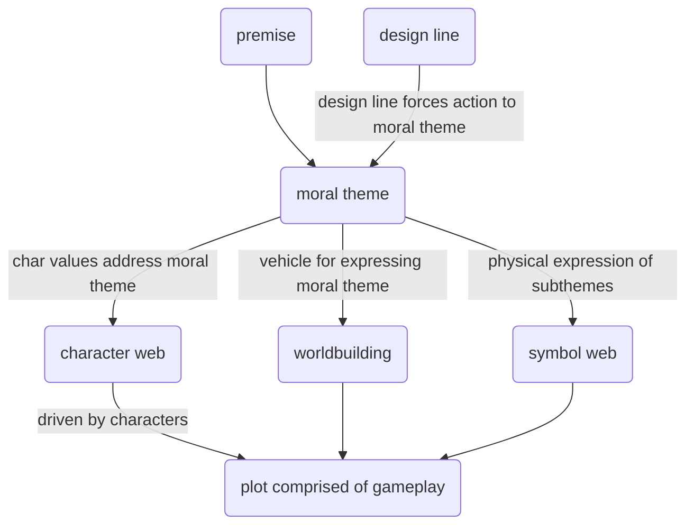

# Premise
Dating Sim is the revenge story of a young man, Kai (That mf Dog) who enrolls in the elite, competitive military school. Famed for its ability to produce some of the finest military combatants the world's ever seen, they employ a stack ranking system that places students into tiers based on their combat abilities demonstrated during the hugely popular gladiatorial combat called Royales held every Friday night. The story follow's Kai's journey from a weak, pitiful being who starts his journey being savaged and through dating SIM gameplay to increase his stats or develop his relationships and roguelike top down gameplay during the Royales, until he is the one who savages. 

## Moral Theme 
Not everybody has the same role in life. Accept the world around you. Accept the circumstances of your life. Accept who you are. And facilitate the role that you were meant to live. 

- sometimes that role changes over time
- sometimes that role changes based on context
- sometimes that role comes without any power... 
- sometimes that role is being the one that is powerful 
- sometimes that role is not what your parents expect of you

# World Building
- Elite school that takes place at the base of a mountain close to an ocean beach.
	- Competition is the heart of improvement is the motto of the school.
	- False Equal Opportunity: All characters start at lowest tier and work their way up. 
		- It's supposed to be some kind of play on democracy and the ability for someone to move up through the classes through their hard work. 
			- (It also helps with scaling issues for creating a shit ton of characters). 
			- As you move up through the classes your class mates get narrowed down and there are less and less people. The classes and teachers become of a higher quality. You are treated with more respect. Better food. Better pussy. More vanilla sex at the beginning of the game because of the lack of stimulus. But then more raunchy, hardcore sex as the game progresses. 
				- It's all a facade though. Characters from certain families and upbringings will always find their way to the top
- Starts in winter. Characters shed more and more clothes as it becomes summer

## Artstyle
Traditional value and primary scaling issue is art. Generating unique CG's for each scene. 
1. issue with just cg's is it's an abstraction over the game world. you exist in the game world but the CG's are just a depiction of it. it feels seperate
2. no opportunity for player expression. 

Reverse traditional filmmaking tropes. Establishing -> middle -> detail. 
Instead start with detail to tease viewer. Build up to what they're trying to see. 

### Asset Types
1. Generic Pixel 3/4 Perspective Top Down Animations
2. Dynamic Lighting 

#### Layered Portraits
1. Clothing changes
2. Expression Changes
3. Generic Poses
4. One unique animated CG per scene

#### Detail Shot Ideation
- Text messages.
- Examine environments. 
- Speech bubble detail shots
	- Speech bibles out of portraits 
	- Action reaction. Left right. 
	- Select speech bubble. 
- Let's you kee teasing or go straight to pound town. Go down kink. Normal. 
- Select speech bubble. 
	- Let's you kee teasing or go straight to pound town
	- speech bubbles contain detail shots
- How to get Detail Shots?
	- Want to give it a more cinematic feel... control the camera. and create interesting poses.. angles. composition. 

# Gameplay 
Pleasuring yourself while gaming compromises general gameplay tenet (gameplay should be the primary vehicle for delivering story narratives). Instead the game attempts to use h scenes as a reward for contextualized, diverse gameplay.

# Characters

## Design Tenets
1. School Uniform
2. Modern Interpretation of JRPG Classes
   1. Design elements that evoke imagery, rather then anachronistic inserts of JRPG objects
      1. For example, ipod strap that evokes ninja tool imagery
   2. Jacket, or standard blazer & replace inner shirt 
3. Animal motifs (right now referencing zodiac animals)

## Berserker
- [[berserker]]

## Mage
- [[mage]]

## Witch 
- [[witch]]

## Knight
	1. Loyalty??? -> Masochism
		1. Spank Training
		2. Typically isn't hit hard enough to feel anything
		3. Defender of priestess
		4. Likes being savaged in battle
		5. succeptible to poisons/potions
		6. Finisher her under a potions influence
		7. In her nature to defend and take pain
		8. Blindfold
	2. Horse 

## Dancer 
1. Bard -> Dancer 
	1. Kpop, Egirl, Cheerleader, Gymnast, Breaker
2. Exhibitionism
	1. Tan lines, Nude beach, Pure exhibitionism, Remote controlled vibrator, against glass, in the middle of school, in public 
	2. When the sun shines and makes it transparent
3. Rabbit
4. Struggle with having to maintain image and grace. Wants to free herself from societal expectations. 

## Thief
1. Thief / Swordmaster / Agility Type Char  / Assassin
	1. Steetwear
2. Stealing? Taken care of? Princess Kink? From rough conniving / Praise Kink. Alternatively, true nature is to be sneaky. Cheating kink. Getting off on humiliating and cucking the rooster. 
3. Rat / Fox 
4. role in the main storyline manipulates others. 
5. doesn't want to manipulate? be taken care of... alternatively fucking looooOoves manipulating others and sneaking around. in her nature to do so.
6. provides cryptic hints and KBU's throughout the game. think half blood prince
7. she leaves little rats who give you ideas around the game world (or rats are enemies in game that you can get hints from) 

- The Fox
	- sly, cunning. 
	- The Stag is in love with The Fox
	- however, your synergy with female teammate is palpable. You HAVE to use her in order to win. 

## Cleric
Stella
1. Priestess, Cleric 
2. Purity, Pride, Chasity
3. The Tiger
4. gives herself to the highest power.... that highest power is god?

- The Lioness is the Villian is your ex. Who humiliated you at the top tier. She's with the other villian. They are fucking greek gods. The golds. She got fucked in front of you bro. She cucked you. You going to take that? Or will you prove them Wrong. DO what it takes to be better then everyone. 
	- hypergamy. attach herself to the winner
	- Top woman. This is the way of the world. I'm a top tier women. Haughty. Better than you. But supremely feminine. I will do anything. Submit. 
	- Supremely strong. 
	- Top girl was your childhood friends. You were lovers

## Ranger
The Rooster
- The Stag is injured high tier who clearly has that dawg in em. 
	- He's probably the strongest stat wise in the game but will not do dishonorable tactics
	- your moral foil, 
	- think lelouch and suzaku
	- Will do everything in his own power but will not take others down or betray his people
	- teammate is your best friend. he's awesome. a kindred flame. but he doesn't have what it takes to be number one. 

## Vampire
The Monkey
- The Vampire: Tier 1, In the first layer you shed the victim mentality. 
	- another example of a character who is a leech and simply uses his relationships to achieve power. a facade but offers nothing in return 
	- Your first victim. You have to step over the slacker. The energy vampire. Someone who wouldn't even put in the effort but wants the reward to move on.  

## Merchant (Item, Chef)
The Pig

## The OX
???
- MENTOR character. he's the one who teaches you and makes you better. but he also thinks he's better than you. obviously shows it because he's a tier above you. 

## ??? The Dragon 
- The Wolf. top fucking dog. whos savages you at every opportunity. 
	- primary antagonist and motivator. 

# Symbol Web
- Sigma male versus the connection route. 
	- If there are a thousand winners I will be one of them
	- If there's one I will be that one
	- If there are none, I will have died trying. 
	- FIGHT. FUCK. 
-  Rites of Passages and Tiers, Doors and walls as barriers to what you want
	- to become a man you need explicit stress inflicted on you
	- becaues of the tightening of restrictions you have clear 
	- Don't open the door. 
	- doors with chians
	- your goal is to conquer the women in this school.
	- magical school?
- Animal Kingdom. Wolves. Dogs. Red Rising titles. the Jackals. The Reaper
	- the lone wolf
	- strength of the wolf. 
	- alpha wolf was wrong.
		- no it's more right then it's ever been
		- we are nothing but captive wolves
	- livestock
		- given "safety". shelter. jobs to do. instructions to procreate to prop up this system. 
	- Over the past year I started dreaming that I’d visit the cabin and the wild dog was locked away, forgotten, emaciated and neglected. I’d show up and he’d be desperate to escape and run in the wild. He felt betrayed and angry for being locked away. I didn’t know what it meant at the time.
		- the alpha wolf and the deer.

# Design Line and Scenes
- Inspired by the dichotomy of Dating SIMS of pushing stats to push relationship points. Progressing your stats in a sociopathic way and saying whatever characters want to hear in order to sleep with them and the typical vanilla love stories that happen in them with examples like childhood friends. 
	- Saying what people want to hear versus saying what you want to say. 
	- Kai starts as a moral man who simply wants to protect himself and his circle. However to progress his own growth (stats) he will be presented with situations and decisions that increase his strength and ability to protect his circle but slowly closes that circle until he finds that it's only himself. 
	- Think Red Rising's humiliation and rise. Getting pissed on to pissing on others. 
- Build up of Tension is VERY important with characters, conflict, sex scenes

The game starts like a regular dating sim with simple stat progression and character progression allowing you to progress. But as you go on, characters become more depraved, motivations become more selfish and more drastic action is required to progress in battle. 

1. sex is incidental 
	1. it's a natural progression based on characters and storyline

[[1-storyline]]

# Sort
- Operator. Low god. One believer. 
- Act 1
	- Fight Lone wolf. Disgraced prince. 
	- Can I do it? Affirm!!!
	- You sleep with her after. Convinced you to stay low. 
	- When you choose to ascend over her that’s when she spirit bombs. She believes in you. But gets disabled in the mean time. You gotta fuck other chicks to ascend. Power corrupts. 
	- Weak. Couldn’t even protect his woman. Demerits on this fight. But I won! And do you call this a victory? Points to infirmary where isla is sleeping. 
	
- Act 2
	- You have to betray disgraced princes who’s been your homie. 
- Act 3
	- You will never enter inner sanctum. Discover lesbians 
	- To ascend you need high level advocates. You discover knight's secret After blackmail she agrees to be your guardian. She’s a lesbian. Masochist. Loves the pain. Helps you ascend. 
- Hidden Act
	- Power corrupts. You were directed by higher powers to win
		- There’s an exhibition match after boys versus girls. Your reconcile with the men